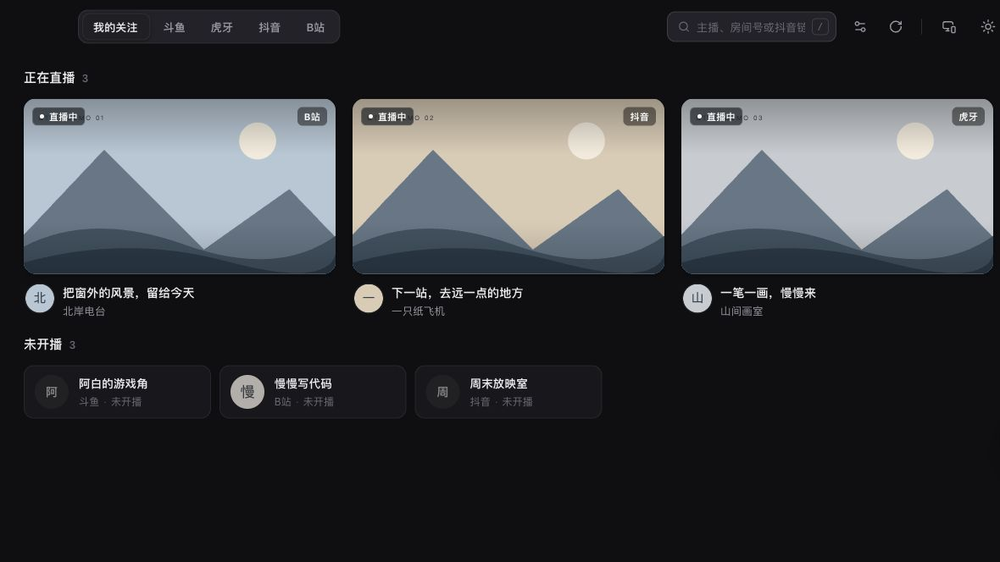
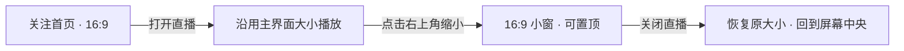
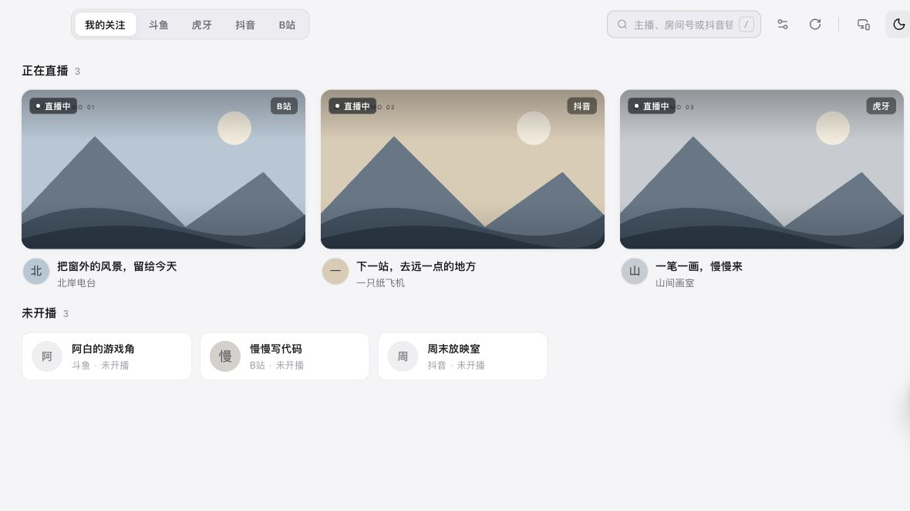
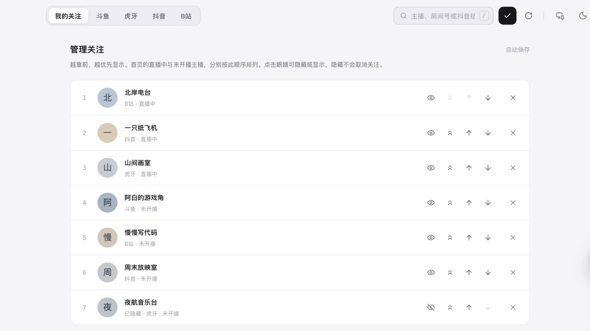

<div align="center">
  
  <h1>QTV</h1>
  <p><strong>打开，就是你关注的直播。</strong></p>
  <p>为 Mac 打造的轻量直播播放器 · 斗鱼 / 虎牙 / 抖音 / 哔哩哔哩</p>
  <p>
    <a href="https://github.com/qinxianhahaha/QTV/releases/latest">下载 macOS 安装包</a> ·
    <a href="#安装">安装方式</a> ·
    <a href="#从源码构建">从源码构建</a> ·
    <a href="https://github.com/qinxianhahaha/QTV/issues">反馈问题</a>
  </p>
</div>

QTV 基于 [DTV](https://github.com/chen-zeong/DTV) 改进，保留多平台直播能力，把「我关注的人」放在首页。它适合已经知道自己想看谁、希望少一点干扰的 Mac 用户。

## 看自己关注的

- **关注即首页**：开播中的主播集中显示，未开播的主播保持紧凑排列；搜索、刷新和管理收在顶部。
- **播放中换台**：播放器右上角的上、下箭头按关注顺序循环切换直播间，跳过隐藏和已确认未开播的主播，支持跨平台切换。
- **顺序由你决定**：在管理里上移、下移或置顶。眼睛按钮可以隐藏主播，关注关系仍然保留。
- **三分钟刷新一次**：后台自动检查开播状态；播放直播、窗口不可见时暂停不必要的刷新。
- **抖音链接直接打开**：支持房间号、`live.douyin.com/...` 和 `douyin.com/follow/live/...` 的完整链接。短链接暂不支持自动展开。



## 大屏看，也能小窗陪着你

打开直播先沿用主界面大小。点击右上角缩小按钮后进入小窗，小窗的右上角对齐点击位置；靠近屏幕边缘时自动保持在可见区域。可以置顶，关闭直播后主界面恢复原先大小并回到屏幕中央。

主界面和小窗都保持 **16:9**。鼠标离开或停止操作后，主播信息和控制栏自动隐藏。点击右上角缩小按钮左侧的「播放信息」，可查看直播每秒接收速度（KB/s、MB/s）、近 10 秒平均网速、对应 Mbps、预计每小时流量，以及实际分辨率、帧率、编码、线路、缓冲与丢帧；点击面板外或关闭按钮即可收起。流量来自本机播放通道实际接收的字节，不含弹幕、封面和网络协议开销；关闭直播直连时，部分远端播放通道暂不支持流量统计。



## 明暗两色，保持克制

黑白双翼电视图标，柔和的状态标记，适配不同窗口尺寸。切换明暗主题时尽量避免文字反色闪烁。



在管理列表里调整顺序，或用眼睛按钮暂时隐藏。



> 介绍图使用演示关注数据，不包含个人订阅、登录信息或真实直播内容。

## 在 DTV 基础上做了哪些调整

| 方向 | QTV 的调整 |
| --- | --- |
| 日常入口 | 默认进入关注首页，顶部集中搜索与管理，减少重复标题 |
| 关注管理 | 优先级排序、隐藏但不取关、取消关注后撤销 |
| Mac 窗口 | 原生 16:9 约束、小窗置顶、点击位置锚定、退出小窗居中恢复 |
| 播放界面 | 自适应居中的主播信息、自动隐藏控制、点击空白收起播放信息 |
| 清晰度 | B 站增加匿名播放网关候选；斗鱼比较网页与客户端实际返回的档位；抖音解析结构化高清流；虎牙使用接口返回的新鲜签名地址 |
| 播放资源 | Mac 优先原生 HLS；受控缓冲；只在信息面板打开时采样帧率；隐藏弹幕时停止不必要工作 |
| 稳定性 | 有上限的重试、同档位换线、会话取消与串行切换，避免旧请求覆盖新直播 |
| 安全与维护 | 独立应用标识、受限本地代理、随机配对码、导出排除登录凭据、依赖升级与回归测试 |

**关于“最高画质”**：QTV 会选择当前接口实际提供、设备可播放的最高候选。接口标注的“原画”不一定等于主播上传的源画质；平台、房间、账号权限和网络均可能限制结果。以播放信息里的实际视频尺寸为准，不承诺每个直播间都能匿名获得 1080p60、2K 或 120 帧。

斗鱼使用当前官方网页播放接口获取清晰度，播放页提供“登录斗鱼”入口。浏览器的登录状态与 QTV 独立，需在 QTV 弹出的斗鱼官方登录框完成登录；登录成功后窗口自动关闭，播放器重新请求原画。登录凭据保存在本机 WebKit 中，播放请求由后端携带，不会写入配置导出。可点击“退出登录”清除 QTV 的斗鱼登录状态；即使登录后平台仍限制画质，也会显示实际返回的档位。

硬件能力允许时才优先尝试高效 HEVC；失败后回到 AVC。原生 HLS 有助于减少转封装开销，但不能保证所有设备或直播间的功耗、温度都降低。

## 安装

面向 **macOS 12 Monterey 或更新版本**。目前只支持 **Apple Silicon（M 系列芯片）** 的 Mac；Intel Mac 尚未测试，暂不支持。macOS 版本较旧时，部分直播编码可能不可用。

### 直连播放

点击右上角的 **设置**，在「网络设置」中打开 **直播直连，不使用系统代理**（默认开启）。设置保存在本机，自动保存，下次打开直播生效，无需重启。关闭后，视频恢复原有网络方式；直播信息和弹幕默认直连。

直连模式将视频通过本机通道交给原播放器，HLS 播放列表、视频分片、密钥和初始化数据一起直连。不转码，不改变清晰度、帧率或硬件解码。失败时会显示播放错误，不会悄悄改走系统代理。

此选项绕过系统 HTTP/SOCKS 代理，无法改变系统级 **TUN/VPN** 路由或代理软件提供的 DNS；启用全局接管时，请在代理软件中给 QTV 或直播平台配置直连规则。官方账号登录页面仍遵循系统网络设置。

若系统 DNS 返回代理软件的虚拟 IP 或无法获得公网地址，视频直连通道会通过阿里公共 DNS 的 HTTPS 接口获取真实地址（仅发送 CDN 域名，不发送账号、Cookie 或完整播放链接）。TLS 验证保持开启，不修改系统 DNS 或代理配置。

### DMG 安装（推荐）

1. 打开 [Releases](https://github.com/qinxianhahaha/QTV/releases/latest)。
2. 下载 `QTV_版本号_aarch64.dmg`。
3. 打开 DMG，将 **QTV** 拖到 **Applications / 应用程序**。
4. 从应用程序启动 QTV。

当前社区构建采用 ad-hoc 签名，**尚未经过 Apple Developer ID 签名和公证**。首次启动若被 macOS 拦截，请先核对下载来源和校验值，再按 [Apple 官方说明](https://support.apple.com/102445) 在“系统设置 → 隐私与安全性”中选择“仍要打开”。不需要关闭系统整体安全保护。

Release 同时提供 ZIP 和 `SHA256SUMS.txt`。校验示例：

```sh
shasum -a 256 ~/Downloads/QTV_1.1.5_aarch64.dmg
```

将输出与同一 Release 的 `SHA256SUMS.txt` 对照。

### Homebrew

本仓库自带 Cask，通过自定义 tap 安装（同样仅支持 Apple Silicon）：

```sh
brew tap qinxianhahaha/qtv https://github.com/qinxianhahaha/QTV
brew install --cask qinxianhahaha/qtv/qtv
```

更新：

```sh
brew update
brew upgrade --cask qinxianhahaha/qtv/qtv
```

这不是 Homebrew 官方仓库中的 Cask；下载仍来自本项目 GitHub Releases。

### 从 DTV 迁移

QTV 使用独立的应用标识，可与 DTV 共存。先在 DTV 的数据同步中导出 JSON，再到 QTV 的数据同步中导入即可。关注、分组及弹幕设置会合并；登录状态需要重新登录。不要把含有个人配置的导出文件提交到 GitHub。

局域网同步仅在主动开启时运行，每次生成随机配对码。另一台 QTV 可以粘贴完整共享链接，或输入 IP 和配对码；关闭同步窗口即停止共享。它使用局域网 HTTP，请只在可信网络中使用。

## 从源码构建

需要 macOS、Xcode Command Line Tools、Node.js 22 LTS、pnpm 11、rustup、稳定版 Rust、Protobuf、pkg-config。安装过依赖后可跳过对应命令。项目只为旧 TARS 依赖启用局部编译兼容设置。

```sh
xcode-select --install
brew install node@22 pnpm rustup protobuf pkg-config
export PATH="$(brew --prefix node@22)/bin:$(brew --prefix rustup)/bin:$HOME/.cargo/bin:$PATH"
rustup default stable

# 获取源码
git clone https://github.com/qinxianhahaha/QTV.git
cd QTV
pnpm install --frozen-lockfile

# 单元测试与类型检查
pnpm check

# 启动开发环境
pnpm tauri dev

# 构建当前 Mac 架构的 .app 和 .dmg
RUSTUP_TOOLCHAIN=stable RUSTC_BOOTSTRAP=tars_stream pnpm tauri build --bundles app,dmg
```

构建结果位于 `src-tauri/target/release/bundle/`。`src-tauri/rust-toolchain.toml` 指定后端工具链；第一次构建会下载 Rust 组件和 V8 预编译库。需要几分钟，并占用数 GB 空间。

跨架构构建与发布流程见 [开发说明](docs/DEVELOPMENT.md)。常见问题见 [FAQ](docs/FAQ.md)。本次检查范围、测试结果和已知限制见 [发布审查记录](docs/RELEASE_REVIEW.md)。

## 技术与许可

Tauri 2 · Rust · Next.js / React · 系统 WebView · xgplayer。

QTV 按 **[AGPL-3.0](LICENSE)** 开源，原 DTV 的 MIT 声明保留在 [LICENSES/DTV-MIT.txt](LICENSES/DTV-MIT.txt)。项目继承的抖音签名脚本来自 AGPL-3.0 项目，因此没有将整个派生作品简单标为 MIT。各组件的来源和许可见 [第三方说明](THIRD_PARTY_NOTICES.md)。

感谢 [DTV](https://github.com/chen-zeong/DTV)、[biliup](https://github.com/biliup/biliup)、[DouyinLiveWebFetcher](https://github.com/saermart/DouyinLiveWebFetcher)、[blivedm](https://github.com/xfgryujk/blivedm) 及相关开源项目。

QTV 不提供直播内容，与各直播平台无隶属关系。直播、头像和平台商标属于各自权利人；使用时请遵守对应平台规则。
